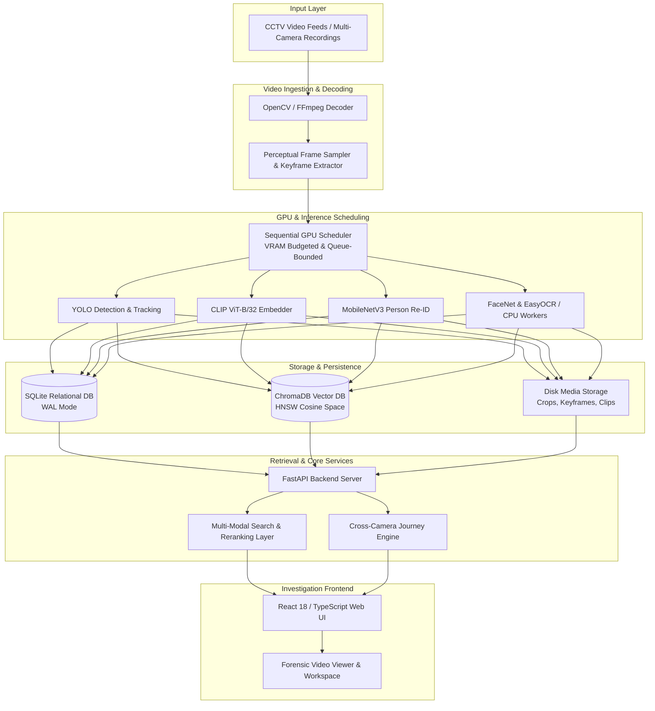

# AICatch — Forensic Multi-Camera CCTV Investigation Platform

AICatch is an AI-assisted forensic video investigation platform designed for analyzing, indexing, and reconstructing events across multi-camera CCTV feeds. It processes raw video footage into synchronized relational metadata and high-dimensional visual vector embeddings, enabling investigators to perform natural language search, reference image search, person re-identification, and cross-camera journey reconstruction with frame-accurate timestamp provenance.

---

## Overview

Forensic video analysis in multi-camera CCTV environments is traditionally labor-intensive, requiring investigators to manually scrub hours of footage across disparate camera angles. AICatch provides a local-first, GPU-accelerated pipeline that automatically detects targets, extracts visual embeddings, identifies keyframes, and indexes spatial regions into structured databases.

Key objectives of the platform:
- **Local-First & Privacy-Preserving**: Runs locally on forensic workstations with no external cloud dependencies for video or embedding processing.
- **Resource-Budgeted Execution**: Tailored for desktop and laptop GPUs (e.g., NVIDIA RTX 3050 with 4 GB VRAM) through sequential scheduling and explicit VRAM ceilings.
- **Multi-Modal Retrieval**: Combines semantic text queries, visual crop references, scene-level keyframes, and localized spatial tile indexing.
- **Temporal Provenance**: Every observation maintains immutable links to exact video files, source cameras, frame indices, and wall-clock timestamps.

---

## Core Capabilities

- **Multi-Camera & Single-Video Workspaces**: Create, manage, and isolate forensic investigations scoped by case, supporting both single-camera recordings and synchronized multi-channel camera deployments.
- **Target Detection & Tracking**: Automated detection and multi-frame tracking of persons and vehicles using YOLO models (YOLO11s active, YOLOv8 fallback) with bounded GPU queue management.
- **Hybrid Visual Indexing**:
  - **Object Crop Indexing**: Extracts bounding box crops of detected subjects, indexing visual features via CLIP ViT-B/32 (512-D) and person Re-ID via MobileNetV3 (576-D).
  - **Scene Keyframe Indexing**: Extracts adaptive scene keyframes using perceptual deduplication (HSV color histogram and spatial delta thresholds) to capture environmental context and non-detected subjects.
  - **Region Tile Indexing**: Partitions keyframes into spatial grid tiles ($432 \times 243$) to index localized background and stationary objects.
- **Facial & Text Attribute Enrichment**: Secondary CPU-based enrichment executing FaceNet (InceptionResnetV1) for facial features and EasyOCR for license plates and visible text.
- **Cross-Camera Journey Reconstruction**: Reconstructs subject transit timelines across non-overlapping camera feeds using Re-ID similarity and chronological sequence analysis.
- **Forensic Video Viewer**: Web-based synchronized video player with exact frame-accurate timestamp seeking and dynamic bounding box overlays.
- **Evidence Management**: Organize, tag, and bookmark visual observations and notes into structured investigation evidence folders.
- **Sequential GPU Scheduling**: Thread-locked inference worker with dynamic VRAM budgeting and queue limit controls to prevent CUDA out-of-memory (OOM) faults.

---

## System Architecture



---

## Technology Stack

### Backend & AI Pipeline
| Component | Technology | Description |
|---|---|---|
| **API Framework** | FastAPI / Uvicorn / Pydantic | Asynchronous REST endpoints and Server-Sent Events (SSE) |
| **Deep Learning Runtime** | PyTorch (CUDA 12.1+ / FP16 AMP) | GPU-accelerated tensor execution and inference |
| **Object Detection** | Ultralytics YOLO (YOLO11s, YOLOv8) | Person and vehicle bounding box detection and tracking |
| **Visual Embeddings** | CLIP ViT-B/32 (HuggingFace Transformers) | 512-dimensional normalized vision-language embeddings |
| **Person Re-ID** | MobileNetV3 Re-ID (Torchvision) | 576-dimensional metric feature extractor for person tracking |
| **Facial & Text Analysis**| FaceNet (facenet-pytorch) & EasyOCR | Secondary CPU-based facial recognition and OCR text extraction |
| **Vector Storage** | ChromaDB (HNSW cosine space) | Multi-collection high-dimensional embedding index |
| **Relational Storage** | SQLite (WAL mode, sqlite3) | ACID-compliant storage for tracks, detections, and case metadata |
| **Media & Video Processing**| OpenCV & FFmpeg | Hardware-accelerated decoding, cropping, and thumbnailing |

### Frontend Application
| Component | Technology | Description |
|---|---|---|
| **Core Framework** | React 18, TypeScript, Vite | Single-page forensic investigation application |
| **Styling & Layout** | Dark Forensic Theme (CSS Modules / Tailwind) | High-contrast UI optimized for video analysis |
| **Icons & UI Elements** | Lucide React | Modern forensic tool icons and action indicators |
| **Video Playback** | HTML5 Video API | Custom synchronized player with coordinate bounding box overlay |

---

## Processing Pipeline

```
Raw Video Files
  │
  ├── 1. Ingestion & Decoding: OpenCV/FFmpeg decodes video frames at configured sampling rates (Fast: 4.0s, Balanced: 2.0s, Forensic: 0.5s).
  │
  ├── 2. Scene & Region Extraction: Perceptual deduplication extracts adaptive keyframes; spatial grid partitions keyframes into 432×243 region tiles.
  │
  ├── 3. GPU Worker Queue: Bounded frame queue (max 64 frames) prevents RAM saturation; locks GPU access for thread-safe inference.
  │
  ├── 4. Detection & Tracking: YOLO detects person and vehicle instances; tracker links multi-frame trajectory tracks.
  │
  ├── 5. Visual Embedding Extraction:
  │     ├── Target Crops → CLIP ViT-B/32 (512-D) + MobileNetV3 Re-ID (576-D)
  │     ├── Scene Keyframes → CLIP ViT-B/32 (512-D)
  │     └── Region Tiles → CLIP ViT-B/32 (512-D)
  │
  ├── 6. Secondary Enrichment (CPU): FaceNet extracts facial embeddings from high-resolution faces; EasyOCR processes vehicle plates and signs.
  │
  ├── 7. Storage Persistence: Bounding boxes and metadata are committed to SQLite; vector embeddings are batch-upserted into ChromaDB collections.
  │
  └── 8. Retrieval & Reconstruction: Search layer executes multi-modal similarity queries, passing results to Journey Engine and Investigation UI.
```

---

## Visual Retrieval Architecture

The search engine partitions visual representations into three distinct collections to prevent cross-modality distortion:

1. **Object / Track Embeddings (`visual_clip_vit_b32_v1`, `reid_mobilenet_v3_v1`)**:
   - Indexes tightly bounded crops of detected individuals and vehicles.
   - Primary modality for specific suspect identification, clothing matching, and vehicle retrieval.
2. **Scene Keyframe Embeddings (`scene_clip_vit_b32_v1`)**:
   - Indexes complete, uncropped frames selected when camera perspective or lighting changes.
   - Used for environmental queries, ambient context matching, and scene-level text search.
3. **Region Tile Embeddings (`region_clip_vit_b32_v1`)**:
   - Indexes fixed spatial grid partitions ($432 \times 243$) of keyframes.
   - Enables localized search for stationary background objects or partial subjects without requiring detector triggers.

---

## Performance Engineering

The AICatch runtime incorporates dedicated optimizations to maintain stability and high throughput on consumer-grade hardware:

- **Sequential GPU Worker with VRAM Throttling**: A dedicated worker thread serializes model inference, preventing concurrent CUDA kernel launches that cause out-of-memory errors on 4 GB VRAM GPUs.
- **CUDA AMP (Automated Mixed Precision FP16)**: YOLO inference executes under FP16 precision, reducing tensor memory footprint and accelerating compute on NVIDIA Tensor Cores.
- **Perceptual Keyframe Deduplication**: Pre-computes HSV histogram differences and spatial pixel deltas to bypass duplicate static frames before GPU dispatch.
- **CPU Offloading for Secondary Tasks**: Non-critical deep learning models (FaceNet, EasyOCR) execute on CPU worker pools, keeping GPU VRAM dedicated to YOLO, CLIP, and Re-ID.
- **SQLite Write-Ahead Logging (WAL)**: Relational database operations utilize WAL mode with busy timeout handlers to enable high-concurrency background inserts alongside UI queries.

---

## Project Structure

```
AICatch/
├── app.py                         # Streamlit diagnostic interface (legacy)
├── config.py                      # System configuration, paths, hardware limits, and profiles
├── main.py                        # FastAPI web server, REST endpoints, and SSE streams
├── pipeline/                      # Video processing and inference pipeline
│   ├── decoder.py                 # OpenCV/FFmpeg concurrent video decoding
│   ├── dispatcher.py              # Result distribution and batch database commits
│   ├── gpu_scheduler.py           # Sequential GPU worker and VRAM budgeter
│   ├── job_manager.py             # Video ingestion job tracking and state
│   ├── journey_engine.py          # Cross-camera Re-ID transition analysis
│   ├── matcher.py                 # Active query and alert evaluation
│   └── scene_indexer.py           # Keyframe extraction and spatial tile generation
├── storage/                       # Data persistence and vector search
│   ├── cache.py                   # In-memory LRU query and embedding cache
│   ├── media_storage.py           # Disk persistence for crops, keyframes, and clips
│   ├── search.py                  # Stratified hybrid search and scoring engine
│   ├── sqlite_db.py               # SQLite schema, indices, and transactional queries
│   └── vector_db.py               # ChromaDB collection management and cosine search
├── models/                        # Model registry and metadata definitions
│   └── registry.py                # Single source of truth for active and candidate models
├── utils/                         # Monitoring and analysis utilities
│   ├── color_analyzer.py          # Dominant upper/lower body color extraction
│   └── monitor.py                 # Real-time VRAM, GPU, and CPU telemetry
├── frontend/                      # React 18 + TypeScript web client
│   ├── src/
│   │   ├── components/            # Workspace, Video Viewer, Search, and Journey views
│   │   ├── services/api.ts        # REST and SSE client service layer
│   │   └── App.tsx                # Main application navigation and routing
│   ├── package.json               # Frontend dependencies and scripts
│   └── vite.config.ts             # Vite development server configuration
├── benchmarks/                    # Benchmark suites and regression verification
├── scripts/                       # Maintenance and offline utility scripts
├── data/                          # Local runtime data directory (SQLite, ChromaDB, Media)
└── .env.example                   # Environment variable template
```

---

## Getting Started

### Prerequisites

- **Python**: Version 3.10 or 3.11 (PyTorch with CUDA 12.1+ recommended for GPU acceleration)
- **Node.js**: Version 18+ and `npm`
- **FFmpeg**: Installed and accessible on system `PATH`
- **GPU**: NVIDIA GPU with 4 GB+ VRAM recommended (CPU fallback supported)

### 1. Environment Setup

```bash
# Clone the repository
git clone https://github.com/SiddharthaBhat/AICatch.git
cd AICatch

# Create and activate virtual environment
python -m venv .venv

# On Windows:
.venv\Scripts\activate
# On Linux / macOS:
source .venv/bin/activate

# Install Python dependencies
pip install -r requirements.txt

# Configure environment variables
cp .env.example .env
```

### 2. Frontend Installation & Build

```bash
cd frontend
npm install

# For production build:
npm run build

# For local development server (http://localhost:5173):
npm run dev
```

### 3. Starting the Backend Service

From the project root directory:

```bash
python main.py
```

The FastAPI backend server will start on `http://localhost:8000`. API documentation is available at `http://localhost:8000/docs`.

---

## Configuration

Core settings can be configured via environment variables or modified directly in `config.py`:

| Variable | Default | Description |
|---|---|---|
| `PORT` | `8000` | Backend REST server port |
| `HOST` | `0.0.0.0` | Backend binding address |
| `AICATCH_DEVICE` | `cuda` | Primary compute device (`cuda` or `cpu`) |
| `AICATCH_FACE_DEVICE` | `cpu` | Compute device for FaceNet face recognition |
| `AICATCH_OCR_DEVICE` | `cpu` | Compute device for EasyOCR text recognition |
| `AICATCH_MAX_VRAM_MB` | `3000` | Target VRAM ceiling in MB to prevent CUDA OOM |
| `LOG_LEVEL` | `INFO` | Logging verbosity (`DEBUG`, `INFO`, `WARNING`, `ERROR`) |
| `AICATCH_SEARCH_DEBUG` | `false` | Backend search trace logging |

---

## Development & Verification

The codebase includes automated pipeline verification scripts:

```bash
# Run pipeline integrity verification
python verify_pipeline.py

# Run model benchmark verification
python run_model_benchmarks.py
```

---

## Current Status

- **IMPLEMENTED & VERIFIED (41/41 Automated Tests Passing)**:
  - Multi-camera (5 concurrent CCTV channels) and single-video investigation management
  - Sequential GPU scheduler with dynamic VRAM budgeting & FP16 AMP optimization
  - YOLO11s/v8 object detection and trajectory tracking with SQLite WAL persistence
  - Dual-scale spatial micro-tiling (16 macro ~45% + 12 micro ~22% tiles) providing $4.20\times$ tighter focus on small/static objects
  - Bi-directional Person Re-ID candidate expansion & Reciprocal Rank Fusion ($0.6 \times \text{Re-ID} + 0.4 \times \text{Visual}$)
  - Resilient vector querying on large collections (323,072 region vectors) with graceful in-memory fallbacks
  - Strict query intent routing (`person`, `object`, `region`, `scene`) and raw cosine similarity score semantics
  - Temporal occurrence clustering (12.0s window) with multi-camera diversity guarantees
  - FastAPI backend with REST & SSE live telemetry and React 18 + TypeScript forensic UI with synchronized Video Viewer
  - Cross-camera journey timeline reconstruction and case evidence bookmarking
- **SYSTEM PROFILE & HARDWARE CONSTRAINTS**:
  - **Tested Target:** NVIDIA GPU (e.g. RTX 3050 4 GB VRAM) + Intel/AMD CPU (16 GB RAM)
  - **Vector Scale:** Tested across 423,506 vectors in local ChromaDB collections
  - **Query Latency Profile:**
    - Person Search: ~7.8s (CLIP visual + OSNet Re-ID RRF fusion)
    - Scene Search: ~10.9s (20k scene vectors)
    - Region Search: ~12.8s (323k region vectors in Python ChromaDB)
    - Object Multi-Modal Search: ~22-26s (crosses object tracks, micro/macro regions, and scenes)
- **KNOWN LIMITATIONS & FUTURE WORK**:
  - Python ChromaDB linear scan overhead on 300k+ embeddings (migration to native C++ HNSW / Qdrant planned for enterprise scale sub-50ms search)
  - Blurry distant subjects (<20x40 px) rely predominantly on spatial CLIP tiles rather than Re-ID
  - Real-time RTSP camera stream reconnection resilience for 24/7 live edge deployments
